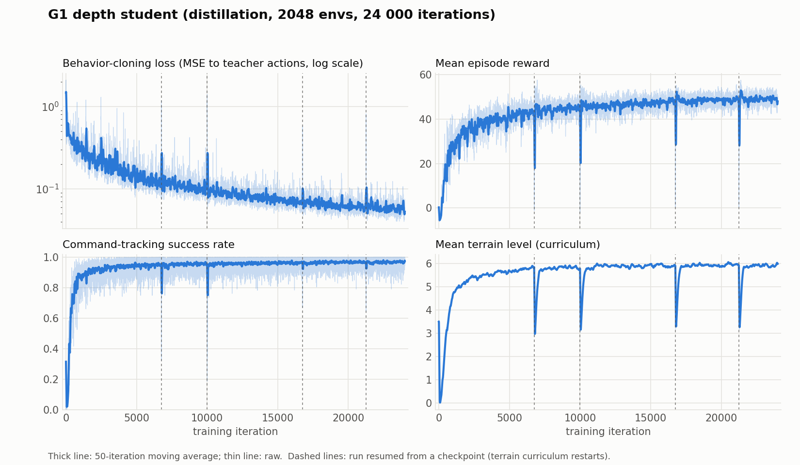
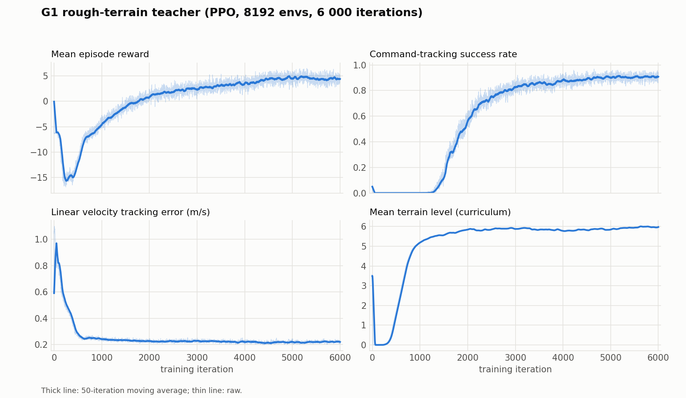

# Unitree G1 depth-camera locomotion in Isaac Lab: training benchmark on a laptop RTX 5080

Training results, checkpoints and exported policies for the upstream Isaac Lab tasks
`Isaac-Velocity-Rough-G1` (teacher) and `Isaac-Velocity-Rough-G1-Depth-Student` (student),
trained end to end on a single 16 GB laptop GPU.

The student walks over rough terrain using only proprioception history and a 64x38 depth image
from a chest camera. It is distilled from a privileged teacher that sees a terrain height scan.


*Chest depth camera of one robot during play (upscaled from 64x38, colored by distance).*

## Summary

| | Teacher | Depth student |
|---|---|---|
| Task | `Isaac-Velocity-Rough-G1` | `Isaac-Velocity-Rough-G1-Depth-Student` |
| Algorithm (RSL-RL) | PPO with symmetry augmentation | Distillation (`MirrorDistillation`, MSE to teacher actions) |
| Observations | proprioception + height scan | proprioception history + 64x38 depth image |
| Network | MLP 512-256-128 | CNN (16-32-32 channels) + MLP 512-256-128 |
| Parallel environments | 8192 | 2048 |
| Iterations | 6 000 | 24 000 |
| Environment steps | 1.18 billion | 1.18 billion |
| Training time | 4.6 h | 13.1 h |
| Time per iteration | 2.75 s | 1.91 s |
| Throughput | about 72 000 steps/s | about 26 000 steps/s |
| GPU memory | not recorded | about 13 GB |

Final training metrics, averaged over the last 100 iterations:

| Metric | Teacher | Depth student |
|---|---|---|
| Command-tracking success rate | 90.7 % | 97.1 % |
| Linear velocity error (m/s) | 0.221 | 0.195 |
| Yaw velocity error (rad/s) | 0.690 | 0.357 |
| Mean terrain level | 5.96 | 6.00 |
| Mean episode length (steps, max 1000) | 926 | 912 |
| Episodes ending in time-out | 84.7 % | 81.4 % |
| Episodes ending by base height | 15.2 % | 18.2 % |
| Episodes ending by base contact | 0.2 % | 0.6 % |
| Mean episode reward | 4.4 | 48.0 |
| Behavior-cloning loss | n/a | 0.053 |

How to read these numbers:

- They are **training-time metrics** logged by the runner, not a separate evaluation run.
- The teacher and student columns are **not a like-for-like comparison**. The teacher was measured
  while exploring with large action noise (action standard deviation 2.15 at the end of training);
  the student acts with a fixed standard deviation of 0.1. That is why the student scores higher
  than the teacher it imitates, mostly through a much smaller action-rate penalty and better yaw
  tracking.
- An episode counts as a success when its mean linear velocity error is below 0.5 m/s and its mean
  yaw velocity error is below 0.8 rad/s.

## Training curves





The same data is available as tables in [results/student_metrics.csv](results/student_metrics.csv)
and [results/teacher_metrics.csv](results/teacher_metrics.csv) (every 25th iteration).

The student run was interrupted four times by GPU driver resets and resumed from the last
checkpoint (iterations 6750, 10000, 16750 and 21250). Each resume restarts the terrain curriculum,
which causes the short dips in the curves; the metrics recover within a few hundred iterations.
The 13.1 h training time counts only the time the five segments were running.

## Setup

| | |
|---|---|
| GPU | NVIDIA GeForce RTX 5080 Laptop GPU, 16 GB |
| CPU | Intel Core Ultra 9 275HX |
| RAM | 32 GB |
| OS | Windows 11 |
| Isaac Lab | `main` at commit `d7e49f0af7ee6dd4e211ecc2ef99628ae91bb290` (2026-11-14), unmodified |
| Isaac Sim | 6.2.0.0 (pip) |
| Physics | Newton with the MuJoCo-Warp solver (the task default), 200 Hz simulation, 50 Hz control |
| Depth rendering | Newton Warp renderer |
| Main packages | rsl-rl-lib 5.5.1, torch 2.11.0+cu130, newton 1.9.0.dev0, mujoco-warp 3.17.0, warp-lang 1.17.0 |
| Seed | 42 |

All task and agent settings are the upstream defaults apart from the number of environments and
iterations. The full resolved configurations are in [params/](params/).

Task details:

- Velocity commands: forward 0 to 1 m/s, yaw rate -1 to 1 rad/s, no sideways or backward commands.
- Episode length 20 s (1000 control steps).
- Depth camera: 64x38 pixels, mounted on the torso link.

## Reproducing

From an Isaac Lab checkout at the commit above:

```
isaaclab train --rl_library rsl_rl --task Isaac-Velocity-Rough-G1 --num_envs 8192 --max_iterations 6000
isaaclab train --rl_library rsl_rl --task Isaac-Velocity-Rough-G1-Depth-Student --checkpoint <path to teacher model_5999.pt> --num_envs 2048 --max_iterations 24000
```

Passing a PPO checkpoint to the student task loads only the teacher weights. Passing a student
checkpoint instead resumes the distillation (student, teacher, optimizer and iteration count).

Notes for 16 GB GPUs:

- The student task defaults to 4096 environments, which does not fit in 16 GB. Training fails with
  a Warp CUDA error 700 and the process hangs instead of exiting. Pass `--num_envs 2048`.
- 2048 environments use about 13 GB of GPU memory.

## Running the trained student

Copy `checkpoints/student_model_23999.pt` into a run folder under
`logs/rsl_rl/g1_rough_depth_student/` (or pass its path), then:

```
isaaclab play --rl_library rsl_rl --task Isaac-Velocity-Rough-G1-Depth-Student --checkpoint <path to student_model_23999.pt> --num_envs 16
```

To record the depth camera, add `--video sensor:depth_camera:depth --video_length 500`
(requires the `video` extra).

## Contents

| Path | What it is |
|---|---|
| `checkpoints/student_model_23999.pt` | Final student checkpoint (RSL-RL format, includes the teacher weights and optimizer state) |
| `checkpoints/teacher_model_5999.pt` | Final teacher checkpoint |
| `exported/policy.pt` | Student policy exported as TorchScript |
| `exported/policy.onnx`, `policy.onnx.data` | Student policy exported as ONNX (keep both files together) |
| `params/` | Resolved environment and agent configurations of both runs |
| `results/` | Training curves and metric tables |
| `media/` | Depth camera clip (original 64x38 MP4 and upscaled GIF) |
| `scripts/play_g1_camera.py` | Plays the student with a live depth-camera panel in the Isaac Sim window |
| `scripts/resume_student.ps1` | Resumes student training from the newest checkpoint (Windows) |

The two scripts contain paths from the machine they were written on; adjust them before use.

## Credits

The tasks, robot model and training code are from [Isaac Lab](https://github.com/isaac-sim/IsaacLab)
(BSD-3-Clause). This repository only adds the trained weights, measurements and two helper scripts.
